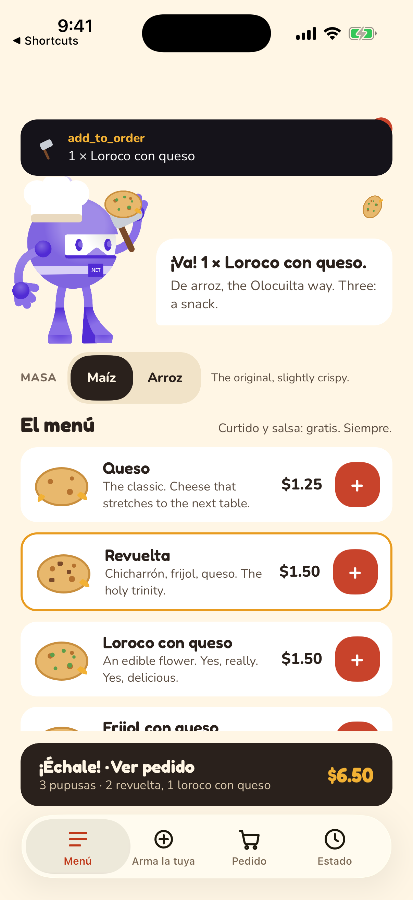

# Pupusería.net

The ordering sample: pupusas, El Salvador's national dish, sold by **Botilio**, the .NET robot in a chef's toque. A
bigger app than TaskTracker and Notes, built to show what Unisono looks like when the tools have shape: a menu to
list, a thing to build with choices, a destructive action worth confirming (placing and paying), and a status to ask
about later. The UI is meant to be funny; the architecture is the same as the other samples.



## What it does

- **Menú**: Botilio greets you, corn or rice masa, six pupusas with prices, a cart bar.
- **Arma tu pupusa**: fillings as chips with a live preview, quantity with Botilio's verdict ("Ten. Respect."), curtido
  and salsa levels up to "modo tía" and "bañada".
- **Tu pedido**: steppers, pickup or delivery, cash, card or Bitcoin ("sí, de verdad"), a tip for Botilio, "¡Échale!".
- **Estado**: the comal with flames and steam, Botilio with his spatula, and the status in pupusa order: palmeada,
  en el comal, volteada, en camino, entregada. A timer advances it every 20 seconds; "Botilio, apúrate" skips ahead.

## The tools (one C# class, every front door)

`Tools/PupuseriaTools.cs` declares seven `[McpServerTool]` methods: `list_menu`, `add_to_order`, `build_pupusa`,
`get_cart`, `place_order` (destructive), `get_order_status`, `clear_cart`. The `Pupusa` entity comes from
`PupusaEntityQuery : IEntityQuery<PupusaDto>`. From that:

- **MCP** serves them on port 8790 (`UnisonoMcpHttpHost`), so an agent can order:
  `python3 ../../scripts/mcp-call.py http://127.0.0.1:8790/mcp call add_to_order '{"pupusaId":"revuelta","quantity":2}'`
- **Siri and Shortcuts** get App Intents generated at build time (`ListMenuIntent`, `BuildAPupusaIntent`,
  `GetCartIntent`, `ClearCartIntent`, the `PupusaEntity` picker, all seven enums as AppEnums). Three intents are
  hand-written in `AppIntents/` because Siri should read Botilio's lines back: `AddToOrderIntent` ("How many?"),
  `PlaceOrderIntent` (confirms the real total first) and `GetOrderStatusIntent`; `PupuseriaShortcuts.swift` owns the
  phrases: "Order two revueltas in Pupusería", "Where is my order in Pupusería", "Échale in Pupusería".
- **Android AppFunctions** list the same seven functions (`Platforms/Android/Assets/app_functions.xml`,
  `PupuseriaAppFunctionService`) for Gemini and the platform tools.

## The animations are the point

Every tool call animates the app, whoever made it. The kitchen (`Services/OrderService.cs`) raises events; the pages
subscribe and animate on the main thread:

- `add_to_order` / `build_pupusa`: a banner slides down naming the tool, Botilio nods and pops a line, the pupusa
  flies from its menu row (or from Botilio's spatula) into the cart badge, the badge bumps, the cart bar flashes.
- `place_order`: the cart empties, the status page flares the comal and Botilio swings the spatula.
- status changes: the flames jump, the step ticks over, the middle pupusa flips on "volteada".

So "Hey Siri, order two revueltas in Pupusería" and an MCP agent calling `add_to_order` produce the same flight.

## Run it

```bash
dotnet build -f net10.0-ios -p:ValidateXcodeVersion=false        # simulator; then install the .app with simctl
dotnet build -f net10.0-maccatalyst -p:ValidateXcodeVersion=false
dotnet build -f net10.0-android -t:Install                       # a device or emulator; adb forward tcp:8790 tcp:8790
```

Verified 2026-11-12 on the iOS simulator (MCP calls animate the UI; the Shortcuts tiles run the generated and the
hand-written intents), and as builds on Android and Mac Catalyst. Fonts: Fredoka and Nunito (OFL). Mascot: the
official dotnet-bot (MIT), with a toque and a spatula added on top.
